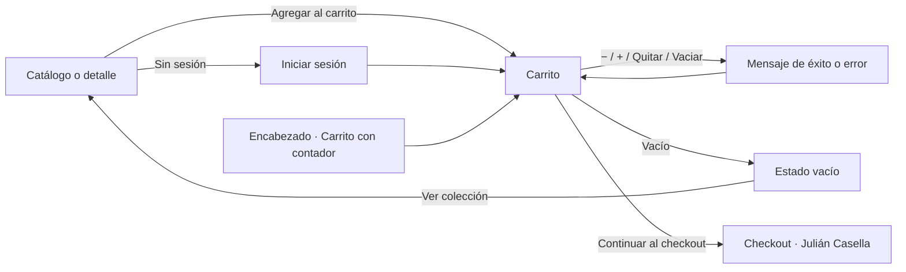

# Módulo de carrito — Cobertura de endpoints y estados

Este documento corresponde a las pantallas asignadas a Ian. El carrito se abre en `/carrito`, requiere sesión (igual que en el backend, donde los endpoints de `/api/carritos` exigen un usuario autenticado) y se puede recorrer completo con los datos simulados de `public/data/`.

## Mockups


El tablero muestra la pantalla de escritorio con la numeración de los endpoints, la versión de celular en una sola columna, el menú móvil, el carrito vacío, el caso sin sesión, los mensajes de respuesta y el recorrido. El mapa de navegación de toda la aplicación está en [mapa-de-navegacion.md](mapa-de-navegacion.md).

## Cobertura de endpoints

Fuente: `CarritoController` del backend (rama `main`).

| # | Endpoint | UI | Servicio | Estados cubiertos |
| --- | --- | --- | --- | --- |
| 1 | `GET /api/carritos/{usuarioId}` | Carga de `/carrito` y contador del encabezado (`CartLink`) | `getCartByUser()` | carga, datos, carrito vacío, carrito inexistente (404), error del servidor (500) |
| 2 | `POST /api/carritos/items` | Botón "Agregar al carrito" (`AddToCartButton`) en las sugerencias del carrito; listo para el catálogo, el detalle y favoritos | `addItem()` | prenda nueva, suma sobre un ítem existente, sin stock (400), stock insuficiente (400), validación de `AgregarItemCarritoDTO` (400 con `errores`), producto inexistente (404), sin sesión → login |
| 3 | `PATCH /api/carritos/{usuarioId}/items/{itemId}` | Botones − / + (`QuantityStepper`) | `updateItemQuantity()` | cantidad actualizada, cantidad 0 quita la prenda, stock insuficiente (400), cantidad negativa (400), ítem inexistente (404), ítem de otro carrito (403) |
| 4 | `DELETE /api/carritos/{usuarioId}/items/{itemId}` | Botón "Quitar" de cada prenda | `removeItem()` | prenda quitada, ítem inexistente (404), ítem de otro carrito (403) |
| 5 | `DELETE /api/carritos/{usuarioId}/items` | "Vaciar carrito" con confirmación | `clearCart()` | carrito vaciado |
| 6 | `POST /api/carritos/{usuarioId}/checkout` | "Continuar al checkout" lleva a `/checkout` (módulo de Julián Casella), que confirma con `useCart().checkout()` | `checkoutCart()` | `CheckoutRespuestaDTO`, carrito vacío (400), stock insuficiente (400) |

No se creó una pantalla por endpoint: la lista, el resumen y las acciones conviven en `/carrito`.

## Contrato de datos

`public/data/carritos.json` contiene un `CarritoRespuestaDTO` por usuario de `usuarios.json` (el backend crea el carrito al registrar la cuenta):

| DTO | Campos |
| --- | --- |
| `CarritoRespuestaDTO` | `id`, `usuarioId`, `items`, `total` |
| `ItemCarritoRespuestaDTO` | `id`, `productoId`, `producto` (nombre), `precioUnitario`, `cantidad`, `subtotal` |
| `AgregarItemCarritoDTO` (solicitud) | `usuarioId`, `productoId`, `cantidad` |
| `ActualizarCantidadItemDTO` (solicitud) | `cantidad` |
| `CheckoutRespuestaDTO` | `mensaje`, `total` |
| `ErrorRespuestaDTO` | `fecha`, `estado`, `error`, `mensaje`, `ruta`, `errores` |

- Los `productoId` coinciden con `productos.json`. Igual que `CarritoRespuestaDTO.fromEntity`, el nombre, el precio unitario, los subtotales y el total se recalculan con el producto actual.
- La foto y el stock que se ven en cada fila no forman parte del DTO: se toman de `productos.json` por `productoId`, del mismo modo que reseñas resuelve el autor por `usuarioId`.
- Los ids de ítem son únicos entre todos los carritos y no se reutilizan, como la identidad de la base.
- Cada error es un archivo `error-carrito-*.json` / `error-item-carrito-*.json` con los mismos mensajes de `CarritoService` y `GlobalExceptionHandler`. Cuando el backend arma el mensaje con el nombre de la prenda, el servicio lo completa.

## Cómo demostrar cada estado

Ingresar con `benja@trama.com` / `trama123` y abrir **Carrito** en el encabezado.

| Estado | Cómo verlo |
| --- | --- |
| Carrito con datos | Benja tiene 3 prendas (7 unidades, total $ 634.700) |
| Cambiar cantidades | Botones − / + de cada prenda |
| Stock insuficiente | Subir la Campera Urban a más de 5 unidades |
| Quitar con cantidad 0 | Botón − sobre una prenda con 1 unidad |
| Agregar | "Sumá más prendas" → Agregar; el contador del encabezado se actualiza |
| Prenda agotada | El Buzo Studio aparece como "Agotado" |
| Vaciar | "Vaciar carrito" → confirmar |
| Carrito vacío | Vaciar, o "Probar estados de la interfaz" → "Carrito vacío" |
| Carrito inexistente (404) | "Probar estados de la interfaz" → "Carrito inexistente" |
| Error del servidor (500) | "Probar estados de la interfaz" → "Error del servidor" y "Reintentar" |
| Errores de las acciones | "Probar estados de la interfaz" → sin stock, más que el stock, cantidad 0, cantidad negativa, ítem inexistente, ítem de otro carrito |
| Sin sesión | Cerrar sesión y abrir `/carrito`: redirige a `/login` |

Los cambios se guardan en memoria mientras la aplicación está abierta; al recargar la página vuelven los datos originales. El stock de `productos.json` no se modifica porque pertenece al módulo de catálogo.

## Integración con otros módulos

**Catálogo y detalle (Alan) y favoritos (Nacho).** El botón se usa con una línea:

```jsx
import AddToCartButton from '../components/carrito/AddToCartButton'

<AddToCartButton productoId={producto.id} stock={producto.stock} />
```

Acepta `cantidad` (por defecto 1), `className` (por ejemplo `product-card__button`), `showFeedback` y un texto como `children`. Sin sesión lleva al login; con stock 0 se muestra como "Agotado". No se modificó `CardProductos`: el reemplazo de su botón queda a cargo de Alan.

**Checkout (Julián Casella).** "Continuar al checkout" navega a `/checkout`. Desde esa pantalla, `useCart()` entrega:

| Valor | Uso |
| --- | --- |
| `cart` | `CarritoRespuestaDTO` con `items` y `total` para el resumen de compra |
| `itemCount` | Cantidad de unidades |
| `checkout()` | `POST /api/carritos/{usuarioId}/checkout`: valida stock, vacía el carrito y devuelve `CheckoutRespuestaDTO` |
| `clearCart()` / `refreshCart()` | Si la confirmación usa `POST /api/ordenes/checkout`, el backend vacía el carrito; en la simulación se refleja con `clearCart()` y con la API real alcanza con `refreshCart()` |

## Wireflow



## Archivos del módulo

```text
public/data/carritos.json                         Un CarritoRespuestaDTO por usuario
public/data/checkout-carrito-response.json        CheckoutRespuestaDTO
public/data/error-carrito-*.json                  Errores del carrito (ErrorRespuestaDTO)
public/data/error-item-carrito-*.json             Errores de ítems (404 y 403)
src/services/cartService.js                       Acceso a datos y reglas simuladas del backend
src/context/CartContext.jsx                       Estado del carrito de la sesión
src/context/cart-context.js, useCart.js           Contexto y hook
src/components/carrito/AddToCartButton.jsx        Botón reutilizable para catálogo, detalle y favoritos
src/components/carrito/CartLink.jsx               Acceso con contador para el encabezado
src/components/carrito/CartItem.jsx               Prenda con cantidad, subtotal y quitar
src/components/carrito/QuantityStepper.jsx        Selector − / +
src/components/carrito/CartSummary.jsx            Resumen, total, checkout y vaciar
src/components/carrito/CartSuggestions.jsx        Prendas para sumar desde el carrito
src/components/carrito/formatPrice.js             Formato de precios en pesos
src/components/carrito/carrito.css                Estilos del módulo, adaptables a celular
src/pages/CartPage.jsx                            Pantalla /carrito
docs/mockups-carrito.svg                          Mockups
```

Archivos compartidos con cambios mínimos: `src/App.jsx` (ruta `/carrito` dentro de las rutas protegidas), `src/main.jsx` (`CartProvider` dentro de `AuthProvider`) y `src/components/layout/Header.jsx` (acceso `CartLink` cuando hay sesión).
