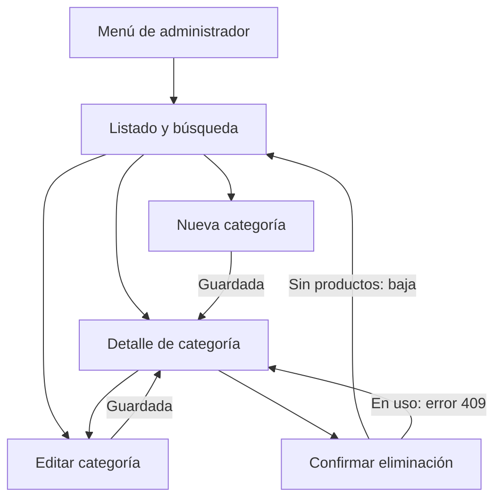

# Categorías — Julieta

## Alcance y diseño

Maquetado e integración estática de la gestión de categorías de TRAMA. Mantiene la
paleta, tipografías, encabezado, componentes UI y sesión simulada del equipo.
El [mockup](mockups-categorias.svg) contiene listado de escritorio, formulario,
detalle/confirmación de eliminación y listado móvil.

## Pantallas y navegación

Todas estas rutas usan el `AdminRoute` ya existente:

| Ruta | Pantalla |
| --- | --- |
| `/categorias` | Listado, búsqueda por nombre exacto o identificador |
| `/categorias/nueva` | Alta con nombre obligatorio |
| `/categorias/:id` | Detalle y confirmación de eliminación |
| `/categorias/:id/editar` | Edición mediante formulario reutilizable |



## Cobertura del backend

| Endpoint | Servicio local | Interacción | Resultado simulado |
| --- | --- | --- | --- |
| `GET /api/categorias` | `getCategories()` | Listado | 200: lista de CategoriaDTO |
| `GET /api/categorias/{id}` | `getCategoryById()` | Detalle o búsqueda por ID | 200 o 404 |
| `GET /api/categorias/buscar?nombre=...&ignorarMayusculas=...` | `getCategoryByName()` | Nombre exacto con casilla para ignorar mayúsculas | 200 o 404 |
| `POST /api/categorias` | `createCategory()` | Nueva categoría | 201 o 400/409 |
| `PUT /api/categorias/{id}` | `updateCategory()` | Editar nombre | 200 o 400/404/409 |
| `DELETE /api/categorias/{id}` | `deleteCategory()` | Confirmación desde detalle | 204 sin contenido o 404/409 |

Los códigos anteriores documentan la API simulada. El navegador sólo solicita
archivos locales mediante GET; todavía no se envían POST/PUT/DELETE a Spring Boot.

## Contratos y datos compartidos

Se conserva `public/data/categorias.json` sin cambios: IDs 1–6 y nombres del equipo.
Cada respuesta individual tiene exactamente `id` (número) y `nombre` (cadena).
Las operaciones de alta/edición reciben `{ nombre }`; el backend genera el ID.
No se agregan `activo`, descripciones, conteos ni campos visuales al DTO.
Los errores mantienen los campos de `ErrorRespuestaDTO`: `fecha`, `estado`,
`error`, `mensaje`, `ruta` y `errores`.

`categoryService.js` carga el JSON una vez, devuelve copias de los DTOs y mantiene
las altas, ediciones y bajas en memoria durante la navegación. Recargar la página
restaura los datos iniciales. Las categorías inactivas se guardan en metadatos
internos y sus nombres no pueden reutilizarse, como en el backend actual.
La comprobación de categoría en uso consulta `productos.json` y sus `categoriaId`.
No se alteran los JSON ni los datos de los otros módulos.

Para conectar la API real se reemplazan las implementaciones del servicio,
conservando sus parámetros y devolviendo DTOs o lanzando errores equivalentes.

## Componentes y estados

- `CategoryTable`: tabla que pasa a tarjetas en móvil.
- `CategoryForm`: formulario reutilizado en alta y edición.
- `DeleteCategoryConfirm`: diálogo nativo, foco inicial en Cancelar y cierre con Escape.
- `useCategory`: consulta compartida por detalle y edición con cancelación al navegar.
- Reutilización de `PageHeading`, `FormField`, `FeedbackMessage` y `LoadingState`.
- Estados de carga, lista vacía, datos, error del servidor y recuperación.
- Validación de nombre vacío, duplicado, ID inválido, categoría inexistente y en uso.
- Selector de estados demostrativos en el listado; volver a datos no borra cambios.

## Recorrido manual de revisión

1. Iniciar sesión como administrador: `admin@trama.com` / `admin123`.
2. Abrir **Categorías** en el menú: aparecen las seis categorías originales.
3. Buscar `remeras` ignorando mayúsculas: aparece Remeras. Desmarcar la casilla:
   el nombre ya no coincide. Buscar `1` por identificador: aparece Remeras.
4. Probar el selector de lista vacía/error y usar **Volver a cargar categorías**.
5. Crear `Accesorios`: aparece el detalle y el mensaje de éxito.
6. Editar a `Accesorios de verano`, volver al listado y comprobar el nuevo nombre.
7. Intentar guardar un nombre vacío o `REMERAS`: se informa la validación/duplicado.
8. Intentar eliminar Remeras: se informa el conflicto por productos asociados.
9. Eliminar la categoría nueva: desaparece del listado. Su detalle devuelve 404.
10. Recargar: se restauran las seis categorías del JSON inicial.
11. Abrir `/categorias/9999` y `/categorias/9999/editar`: mostrar error y regreso.
12. Revisar a 390 px y 1280 px, teclado y navegación sin sesión/con cuenta común.

## Comprobación técnica

Ejecutar `npm run build` y `npm run lint` desde la raíz del frontend.
Pruebas automáticas del contrato y las operaciones simuladas:

```sh
node --test tests/categoryService.test.mjs
```

Cubren nueve escenarios: contrato/listado, búsqueda exacta y mayúsculas,
validaciones, alta/duplicados, edición, categoría en uso, baja lógica,
estados demostrativos y cancelación. No requieren dependencias adicionales.
