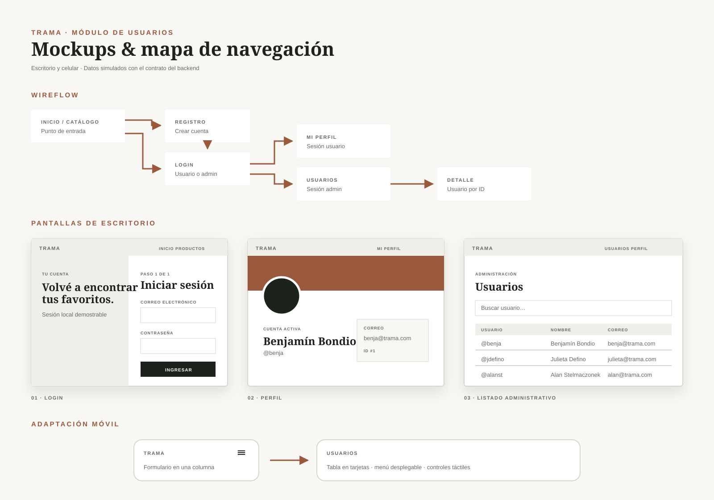
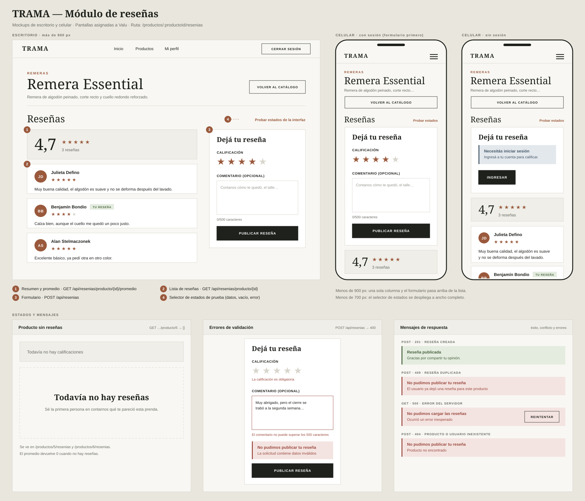
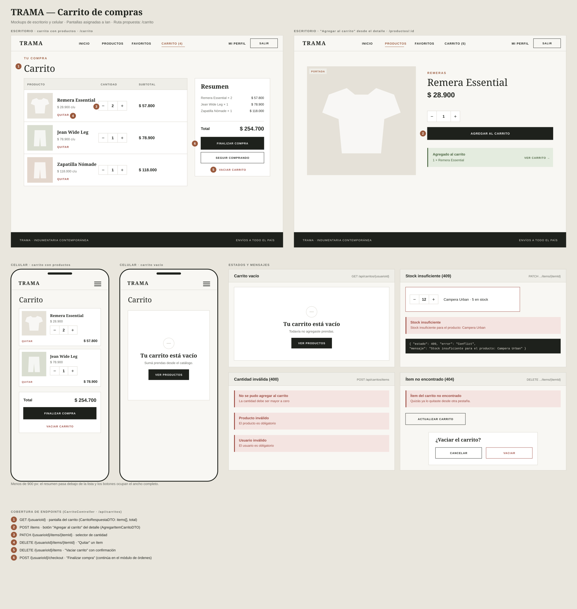
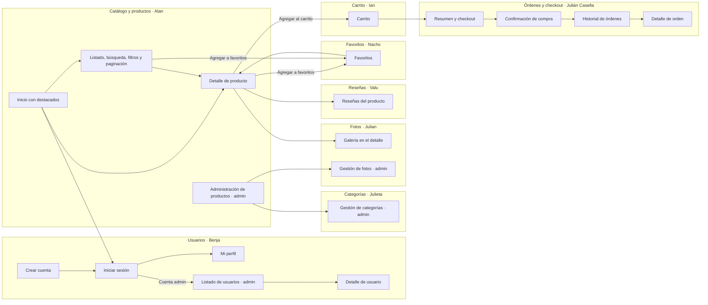

# Mockups y mapa de navegación — Trama (documento consolidado)

Este documento reúne los mockups de todos los módulos y el mapa de navegación completo de la aplicación. Cada integrante entrega sus propias pantallas y Valu las consolida acá.

> Estado: borrador armado a partir de los endpoints del backend y de la división de tareas. Cada responsable completa la columna "Pantalla o acción" de su módulo, agrega su ruta real y enlaza su mockup.

## Mockups por módulo

| Módulo | Responsable | Mockup | Estado |
| --- | --- | --- | --- |
| Usuarios y estructura | Benja | [mockups-usuarios.svg](mockups-usuarios.svg) | Entregado |
| Categorías | Julieta | [mockups-categorias.svg](mockups-categorias.svg) | Entregado |
| Catálogo y productos | Alan | A completar | Pendiente |
| Fotos de productos | Julian | A completar | Pendiente |
| Carrito | Ian | [mockups-carrito.svg](mockups-carrito.svg) | Entregado |
| Órdenes y checkout | Julián Casella | A completar | Pendiente |
| Favoritos | Nacho | A completar | Pendiente |
| Reseñas | Valu | [mockups-resenias.svg](mockups-resenias.svg) | Entregado |

## Mapa de navegación

Los módulos se agrupan por responsable. Las flechas indican el recorrido principal de una persona usuaria; los accesos de administración se proponen desde el menú del encabezado cuando la sesión es de administrador.

## Rutas

| Ruta | Pantalla | Responsable | Estado |
| --- | --- | --- | --- |
| `/` | Inicio y catálogo | Alan | Existe una versión inicial |
| `/login` | Iniciar sesión | Benja | Hecho |
| `/registro` | Crear cuenta | Benja | Hecho |
| `/mi-perfil` | Perfil de la sesión | Benja | Hecho |
| `/usuarios` | Listado de usuarios | Benja | Hecho |
| `/usuarios/:id` | Detalle de usuario | Benja | Hecho |
| `/productos/:productoId/resenias` | Reseñas de un producto | Valu | Hecho |
| A confirmar | Detalle de producto | Alan | Pendiente |
| `/categorias`, `/categorias/nueva`, `/categorias/:id`, `/categorias/:id/editar` | Categorías | Julieta | Implementado |
| A confirmar | Fotos | Julian | Pendiente |
| `/carrito` | Carrito | Ian | Hecho |
| A confirmar | Checkout, confirmación e historial | Julián Casella | Pendiente |
| A confirmar | Favoritos | Nacho | Pendiente |

## Cobertura de endpoints

Fuente: controladores del backend. Son 35 endpoints. Cada responsable completa la columna "Pantalla o acción" indicando qué pantalla, formulario o botón representa a cada uno. No hace falta una pantalla distinta por endpoint.

### Usuarios · Benja

| Endpoint | Pantalla o acción | Estado |
| --- | --- | --- |
| `POST /api/usuarios/registro` | Formulario de registro | Hecho |
| `POST /api/usuarios/login` | Formulario de acceso | Hecho |
| `GET /api/usuarios` | Listado administrativo con búsqueda | Hecho |
| `GET /api/usuarios/{id}` | Perfil y detalle de usuario | Hecho |

### Categorías · Julieta

| Endpoint | Pantalla o acción | Estado |
| --- | --- | --- |
| `GET /api/categorias` | Listado | Implementado |
| `GET /api/categorias/{id}` | Detalle y búsqueda por ID | Implementado |
| `GET /api/categorias/buscar` | Búsqueda exacta por nombre | Implementado |
| `POST /api/categorias` | Formulario de alta | Implementado |
| `PUT /api/categorias/{id}` | Formulario de edición | Implementado |
| `DELETE /api/categorias/{id}` | Confirmación de baja y conflicto por categoría en uso | Implementado |

### Productos · Alan

| Endpoint | Pantalla o acción | Estado |
| --- | --- | --- |
| `GET /api/productos` | A completar | Pendiente |
| `GET /api/productos/buscar` | A completar | Pendiente |
| `GET /api/productos/{id}` | A completar | Pendiente |
| `POST /api/productos` | A completar | Pendiente |
| `PUT /api/productos/{id}` | A completar | Pendiente |
| `PATCH /api/productos/{id}/stock` | A completar | Pendiente |
| `DELETE /api/productos/{id}` | A completar | Pendiente |

### Fotos · Julian

| Endpoint | Pantalla o acción | Estado |
| --- | --- | --- |
| `GET /api/productos/{productoId}/fotos` | A completar | Pendiente |
| `POST /api/productos/{productoId}/fotos` | A completar | Pendiente |
| `PATCH /api/productos/{productoId}/fotos/{fotoId}/portada` | A completar | Pendiente |
| `DELETE /api/productos/{productoId}/fotos/{fotoId}` | A completar | Pendiente |

### Carrito · Ian

| Endpoint | Pantalla o acción | Estado |
| --- | --- | --- |
| `GET /api/carritos/{usuarioId}` | Pantalla `/carrito` y contador del encabezado | Hecho |
| `POST /api/carritos/items` | Botón "Agregar al carrito" (`AddToCartButton`) | Hecho |
| `PATCH /api/carritos/{usuarioId}/items/{itemId}` | Botones − / + de cada prenda | Hecho |
| `DELETE /api/carritos/{usuarioId}/items/{itemId}` | Botón "Quitar" | Hecho |
| `DELETE /api/carritos/{usuarioId}/items` | "Vaciar carrito" con confirmación | Hecho |
| `POST /api/carritos/{usuarioId}/checkout` | "Continuar al checkout" → `/checkout`; se confirma con `useCart().checkout()` (se coordina con Casella) | Hecho del lado del carrito |

### Órdenes y checkout · Julián Casella

| Endpoint | Pantalla o acción | Estado |
| --- | --- | --- |
| `POST /api/ordenes/checkout` | A completar | Pendiente |
| `GET /api/ordenes/historial/{usuarioId}` | A completar | Pendiente |

### Favoritos · Nacho

| Endpoint | Pantalla o acción | Estado |
| --- | --- | --- |
| `GET /api/favoritos/usuario/{usuarioId}` | A completar | Pendiente |
| `POST /api/favoritos` | A completar | Pendiente |
| `DELETE /api/favoritos/usuario/{usuarioId}` | A completar | Pendiente |

### Reseñas · Valu

| Endpoint | Pantalla o acción | Estado |
| --- | --- | --- |
| `POST /api/resenias` | Formulario "Dejá tu reseña" | Hecho |
| `GET /api/resenias/producto/{productoId}` | Lista de reseñas | Hecho |
| `GET /api/resenias/producto/{productoId}/promedio` | Resumen con promedio y cantidad | Hecho |

## Criterios de diseño compartidos

- Paleta cálida: fondo `#f8f7f3`, texto `#1e211c` y acento terracota `#9a593c`.
- Tipografía editorial: Playfair Display para títulos y DM Sans para el resto.
- Botones principales oscuros en mayúsculas, y secundarios con borde.
- Encabezado y pie reutilizables en todas las rutas.
- Cada pantalla muestra sus estados: datos, lista vacía, carga y error.
- Adaptable a escritorio (más de 900 px) y a celular, con una sola columna por debajo de 900 px.

### Diseño de categorías

Mockup: [categorías](mockups-categorias.svg). Rutas, contratos y recorrido de revisión: [diseño de categorías](categorias-diseno.md).
