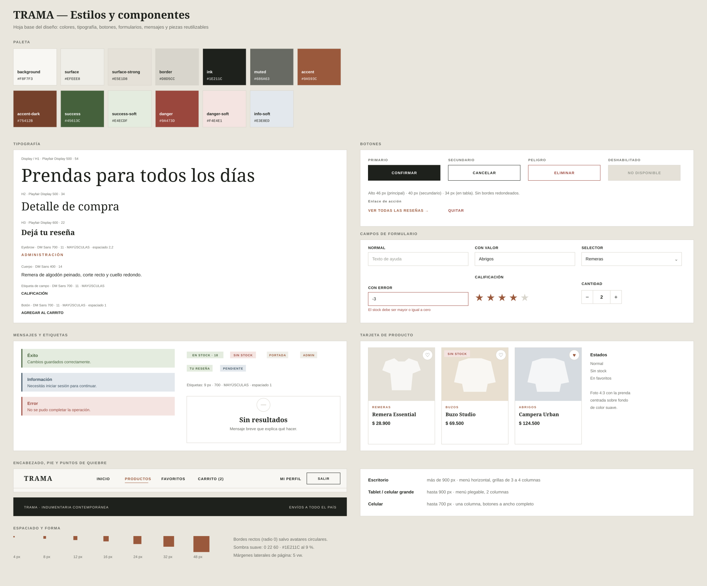
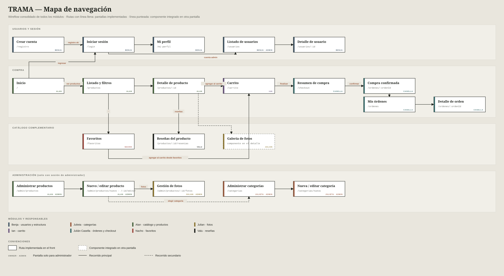
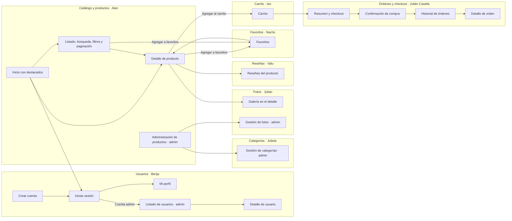

# Mockups y mapa de navegación — Trama (documento consolidado)

Este documento reúne los mockups de todos los módulos y el mapa de navegación completo de la aplicación.

> Los mockups se diseñaron a partir de los DTO, los endpoints y los mensajes de error reales del backend. Todas las rutas descriptas están implementadas.

## Mockups por módulo

Cada tablero reúne las pantallas de escritorio y celular del módulo, sus estados (datos, vacío, carga, error y validación) y la numeración de los endpoints que cubre. Todos usan la misma paleta y tipografía, definidas en la hoja de estilos.

| Módulo | Responsable | Tablero |
| --- | --- | --- |
| Estilos y componentes | Todos | [estilos-y-componentes.svg](estilos-y-componentes.svg) |
| Usuarios y estructura | Benja | [mockups-usuarios.svg](mockups-usuarios.svg) |
| Categorías | Julieta | [mockups-categorias.svg](mockups-categorias.svg) |
| Catálogo y productos | Alan | [mockups-catalogo.svg](mockups-catalogo.svg) |
| Fotos de productos | Julian | [mockups-fotos.svg](mockups-fotos.svg) |
| Carrito | Ian | [mockups-carrito.svg](mockups-carrito.svg) |
| Checkout y órdenes | Julián Casella | [mockups-ordenes.svg](mockups-ordenes.svg) |
| Favoritos | Nacho | [mockups-favoritos.svg](mockups-favoritos.svg) |
| Reseñas | Valu | [mockups-resenias.svg](mockups-resenias.svg) |

## Mapa de navegación

Versión en texto del mismo mapa:

Los módulos se agrupan por responsable. Las flechas indican el recorrido principal de una persona usuaria; los accesos de administración se proponen desde el menú del encabezado cuando la sesión es de administrador.

## Rutas

Todas las rutas están implementadas en el front. Las marcadas como "Admin" requieren una sesión de administrador; las marcadas como "Sesión" requieren iniciar sesión.

| Ruta | Pantalla | Responsable | Acceso |
| --- | --- | --- | --- |
| `/` | Inicio con destacados | Alan | Público |
| `/login` | Iniciar sesión | Benja | Público |
| `/registro` | Crear cuenta | Benja | Público |
| `/productos` | Listado, búsqueda, filtros y paginación | Alan | Público |
| `/productos/:id` | Detalle con galería, favorito, carrito y reseñas | Alan / Julian / Valu | Público |
| `/productos/:productoId/resenias` | Reseñas de un producto (pantalla completa) | Valu | Público |
| `/mi-perfil` | Perfil de la sesión | Benja | Sesión |
| `/usuarios/:id` | Detalle de usuario | Benja | Sesión |
| `/carrito` | Carrito | Ian | Sesión |
| `/checkout` | Resumen de compra | Julián Casella | Sesión |
| `/ordenes` | Historial de órdenes | Julián Casella | Sesión |
| `/ordenes/:ordenId` | Detalle de orden y confirmación de compra | Julián Casella | Sesión |
| `/favoritos` | Lista de favoritos | Nacho | Sesión |
| `/usuarios` | Listado de usuarios | Benja | Admin |
| `/categorias` | Listado de categorías | Julieta | Admin |
| `/categorias/nueva` | Alta de categoría | Julieta | Admin |
| `/categorias/:id` | Detalle de categoría | Julieta | Admin |
| `/categorias/:id/editar` | Edición de categoría | Julieta | Admin |
| `/admin/productos` | Administración de productos y stock | Alan | Admin |
| `/admin/productos/nuevo` | Alta de producto | Alan | Admin |
| `/admin/productos/:id/editar` | Edición de producto | Alan | Admin |
| `/admin/productos/:id/fotos` | Gestión de fotos | Julian | Admin |

## Cobertura de endpoints

Fuente: controladores del backend. Son 28 endpoints. No hay una pantalla distinta por endpoint: cada fila indica qué pantalla, formulario o botón lo representa.

### Usuarios · Benja

| Endpoint | Pantalla o acción | Estado |
| --- | --- | --- |
| `POST /api/usuarios/registro` | Formulario de registro | Implementado |
| `POST /api/usuarios/login` | Formulario de acceso | Implementado |
| `GET /api/usuarios` | Listado administrativo con búsqueda | Implementado |
| `GET /api/usuarios/{id}` | Perfil y detalle de usuario | Implementado |

### Categorías · Julieta

| Endpoint | Pantalla o acción | Estado |
| --- | --- | --- |
| `GET /api/categorias` | Listado de categorías | Implementado |
| `GET /api/categorias/{id}` | Detalle al abrir una fila o entrar a editar | Implementado |
| `GET /api/categorias/buscar` | Búsqueda por nombre | Implementado |
| `POST /api/categorias` | Formulario "Nueva categoría" | Implementado |
| `PUT /api/categorias/{id}` | Formulario "Editar categoría" | Implementado |
| `DELETE /api/categorias/{id}` | Confirmación de eliminación; errores 409 (en uso) y 404 | Implementado |

### Productos · Alan

| Endpoint | Pantalla o acción | Estado |
| --- | --- | --- |
| `GET /api/productos` | Destacados del inicio y listado básico | Implementado |
| `GET /api/productos/buscar` | Filtros combinados y paginación | Implementado |
| `GET /api/productos/{id}` | Detalle de producto | Implementado |
| `POST /api/productos` | Formulario de alta con validaciones | Implementado |
| `PUT /api/productos/{id}` | Formulario de edición | Implementado |
| `PATCH /api/productos/{id}/stock` | Modal "Actualizar stock" | Implementado |
| `DELETE /api/productos/{id}` | Confirmación de eliminación | Implementado |

### Fotos · Julian

| Endpoint | Pantalla o acción | Estado |
| --- | --- | --- |
| `GET /api/productos/{productoId}/fotos` | Galería del detalle y grilla de gestión | Implementado |
| `POST /api/productos/{productoId}/fotos` | Formulario por URL (máximo 10 fotos) | Implementado |
| `PATCH /api/productos/{productoId}/fotos/{fotoId}/portada` | Botón "Hacer portada" | Implementado |
| `DELETE /api/productos/{productoId}/fotos/{fotoId}` | Botón "Eliminar" con confirmación | Implementado |

### Carrito · Ian

| Endpoint | Pantalla o acción | Estado |
| --- | --- | --- |
| `GET /api/carritos/{usuarioId}` | Pantalla del carrito | Implementado |
| `POST /api/carritos/items` | Botón "Agregar al carrito" del detalle | Implementado |
| `PATCH /api/carritos/{usuarioId}/items/{itemId}` | Selector de cantidad | Implementado |
| `DELETE /api/carritos/{usuarioId}/items/{itemId}` | "Quitar" un ítem | Implementado |
| `DELETE /api/carritos/{usuarioId}/items` | "Vaciar carrito" con confirmación | Implementado |
| `POST /api/carritos/{usuarioId}/checkout` | "Finalizar compra" (responde `CheckoutRespuestaDTO`: mensaje y total; la demo confirma con `POST /api/ordenes/checkout`) | Implementado |

### Órdenes y checkout · Julián Casella

| Endpoint | Pantalla o acción | Estado |
| --- | --- | --- |
| `POST /api/ordenes/checkout` | "Confirmar compra" en el resumen; responde 201 con `OrdenRespuestaDTO` (código de seguimiento de 12 caracteres hexadecimales) | Implementado |
| `GET /api/ordenes/historial/{usuarioId}` | Historial y detalle de órdenes | Implementado |

### Favoritos · Nacho

| Endpoint | Pantalla o acción | Estado |
| --- | --- | --- |
| `GET /api/favoritos/usuario/{usuarioId}` | Lista de favoritos | Implementado |
| `POST /api/favoritos` | Botón de favorito en catálogo y detalle | Implementado |
| `DELETE /api/favoritos/usuario/{usuarioId}` | Quitar favoritos. El backend solo vacía la lista completa; quitar una prenda suelta se simula en memoria | Implementado |

### Reseñas · Valu

| Endpoint | Pantalla o acción | Estado |
| --- | --- | --- |
| `POST /api/resenias` | Formulario "Dejá tu reseña" | Implementado |
| `GET /api/resenias/producto/{productoId}` | Lista de reseñas | Implementado |
| `GET /api/resenias/producto/{productoId}/promedio` | Resumen con promedio y cantidad | Implementado |

## Criterios de diseño compartidos

- Paleta cálida: fondo `#f8f7f3`, texto `#1e211c` y acento terracota `#9a593c`.
- Tipografía editorial: Playfair Display para títulos y DM Sans para el resto.
- Botones principales oscuros en mayúsculas, y secundarios con borde.
- Encabezado y pie reutilizables en todas las rutas.
- Cada pantalla muestra sus estados: datos, lista vacía, carga y error.
- Adaptable a escritorio (más de 900 px) y a celular, con una sola columna por debajo de 900 px.
