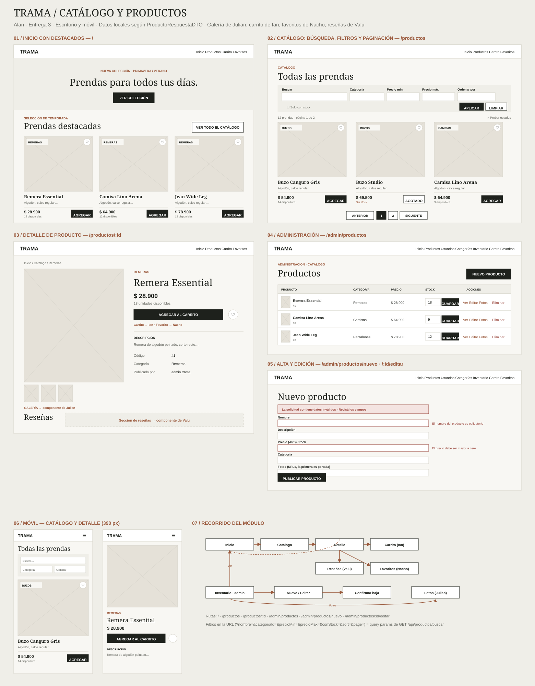
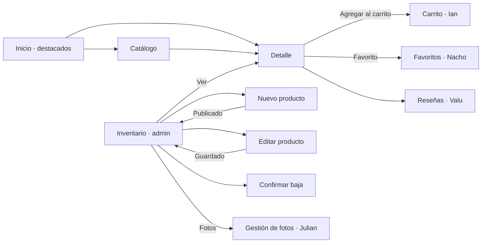

# Catálogo y productos — Alan

## Alcance y diseño

Inicio con prendas destacadas, catálogo con búsqueda, filtros y paginación, detalle de
producto y administración (alta, edición, stock y baja). Mantiene la paleta, tipografías,
encabezado, componentes UI y sesión simulada del equipo. El [mockup](mockups-productos.svg)
incluye las cinco pantallas de escritorio, catálogo y detalle en móvil y el recorrido del módulo.

## Pantallas y navegación

| Ruta | Pantalla | Acceso |
| --- | --- | --- |
| `/` | Inicio con destacados (reutiliza la grilla del catálogo) | Público |
| `/productos` | Catálogo: búsqueda, categoría, precio mín./máx., solo con stock, orden y paginación | Público |
| `/productos/:id` | Detalle: galería, precio, stock, carrito, favorito, descripción y reseñas | Público |
| `/admin/productos` | Inventario: listado, actualizar stock, eliminar | `AdminRoute` |
| `/admin/productos/nuevo` | Alta de producto | `AdminRoute` |
| `/admin/productos/:id/editar` | Edición de producto | `AdminRoute` |
| `/admin/productos/:id/fotos` | Gestión de fotos (módulo de Julian, enlazado desde el inventario) | `AdminRoute` |

Los filtros del catálogo viven en la URL (`?nombre=&categoriaId=&precioMin=&precioMax=&conStock=&sort=&page=`),
con los mismos nombres que los query params de `GET /api/productos/buscar`. Así se puede volver atrás,
recargar o compartir una búsqueda.

## Cobertura del backend

Fuente: `ProductoController` del backend.

| Endpoint | Servicio local | Pantalla o acción | Resultado simulado |
| --- | --- | --- | --- |
| `GET /api/productos?categoriaId=&nombre=&conStock=` | `getProducts()` | Destacados del inicio e inventario | 200: lista de ProductoRespuestaDTO |
| `GET /api/productos/buscar?...&precioMin=&precioMax=&page=&size=&sort=` | `searchProducts()` | Catálogo con filtros, orden y paginación | 200: Page; 400 si el rango de precio es inválido |
| `GET /api/productos/{id}` | `getProductById()` | Detalle (y carga del formulario de edición) | 200 o 404 |
| `POST /api/productos` | `createProduct()` | Formulario "Nuevo producto" | 201 o 400 con `errores` por campo |
| `PUT /api/productos/{id}` | `updateProduct()` | Formulario "Editar producto" | 200, 400, 403 o 404 |
| `PATCH /api/productos/{id}/stock` | `updateProductStock()` | Campo de stock + "Guardar" en el inventario | 200, 400 (stock negativo) o 403 |
| `DELETE /api/productos/{id}?usuarioId=` | `deleteProduct()` | "Eliminar" con diálogo de confirmación | 204, 403 o 404 |

> `GET /api/productos/buscar` ya está integrado en `main` del backend.

Los códigos documentan la API simulada: el navegador solo lee archivos locales; todavía no se envían
POST/PUT/PATCH/DELETE a Spring Boot.

## Contratos y datos compartidos

- `public/data/productos.json`: lista de **ProductoRespuestaDTO** con exactamente los campos del backend:
  `id`, `nombre`, `descripcion`, `precio`, `stock`, `categoriaId`, `categoria`, `usuarioId`,
  `nombreUsuario` y `fotos` (lista de FotoRespuestaDTO: `id`, `url`, `esPortada`).
  Se agregaron los productos 7 a 12; los IDs 1 a 6 no cambiaron (los usan carrito, favoritos, órdenes y reseñas).
- Las categorías (`categoriaId` 1–6 y sus nombres) son las de `categorias.json` (Julieta) y el
  publicador es `admin.trama` (usuario 4 de `usuarios.json`, Benja).
- `public/data/productos-buscar.json`: ejemplo de `GET /api/productos/buscar?page=0&size=6&sort=nombre,asc`.
  Spring Boot 4 serializa la página como `{ content, page: { size, number, totalElements, totalPages } }`;
  **verificar con Postman contra el backend** y, si llega en el formato clásico de `PageImpl`
  (`content`, `totalElements`, `totalPages`, `number`, `size`…), el front ya lo soporta (`readPage()`).
- Altas y ediciones envían el body de **ProductoCrearDTO**:
  `{ nombre, descripcion, precio, stock, categoriaId, usuarioId, fotos: [urls] }`.
  El stock usa **ActualizarStockDTO** `{ usuarioId, stock }` y la baja manda `usuarioId` como query param.
- Errores con la forma de **ErrorRespuestaDTO** (`fecha`, `estado`, `error`, `mensaje`, `ruta`, `errores`):
  `error-producto-no-encontrado.json` (404), `error-producto-validacion.json` (400 con `errores` por campo),
  `error-producto-invalido.json` (400 de `ProductoInvalidoException`), `error-producto-sin-permiso.json` (403)
  y `error-productos.json` (500).
- Reglas replicadas del `ProductoService`: precio mayor a cero, stock no negativo, rango de precio válido
  y solo el usuario que publicó el producto puede modificarlo o eliminarlo (403).

`productService.js` carga el JSON una vez y mantiene en memoria las altas, ediciones, cambios de stock y
bajas mientras se navega (recargar restaura los datos). Carrito y reseñas siguen usando `getProducts()`
y `getProductById()` con la misma firma. Para conectar la API real se reemplaza el cuerpo de cada
función por un `fetch` al endpoint de la tabla, sin tocar las pantallas.

## Componentes

- `CardProductos` (compartida): ahora lleva al detalle con `detalleUrl` y usa `AddToCartButton` de Ian.
  Puede reutilizarse en favoritos (hoy `FavoritesPage` lee `src/data/products.json`).
- `productos/ProductGrid`: grilla de ProductoRespuestaDTO con favoritos; se usa en inicio y catálogo.
- `productos/ProductFilters`, `productos/Pagination`: filtros y paginación de `/buscar`.
- `productos/ProductForm`: formulario reutilizado en alta y edición, con vista previa de fotos.
- `productos/StockForm`: actualización de stock en línea.
- Detalle integra `fotos/ProductGallery` (Julian), `AddToCartButton` (Ian), `FavoriteButton` (Nacho)
  y `ReviewsSection` (Valu). Los precios usan `carrito/formatPrice` (Ian), el mismo formato que el carrito.
- El inventario enlaza cada producto con la gestión de fotos de Julian (`/admin/productos/:id/fotos`).
- Encabezado: "Productos" lleva a `/productos` y, con sesión de administrador, aparece "Inventario".

## Estados

- Carga, datos, lista vacía y error del servidor (selector "Probar estados" en catálogo e inventario).
- Producto inexistente (404) en detalle y edición.
- Validaciones del formulario (400 con mensaje por campo), stock negativo y rango de precio inválido.
- "Simular otro usuario (403)" en el inventario para mostrar el permiso del publicador.
- Diseño adaptable: grilla de 3 → 2 → 1 columnas, filtros apilados y tabla que pasa a tarjetas en móvil.

## Recorrido manual de revisión

1. `/` → "Prendas destacadas" → "Ver todo el catálogo".
2. `/productos` → buscar "buzo", filtrar por categoría, ordenar por precio, pasar a la página 2.
3. Probar precio mínimo 5000 y máximo 100 → mensaje de rango inválido.
4. Abrir una prenda → detalle con galería, carrito, favorito y reseñas. `/productos/99` → 404.
5. Ingresar como admin (`admin@trama.com` / `admin123`) → "Inventario".
6. Cambiar un stock y guardar; probar un stock negativo.
7. "Nuevo producto" → publicar vacío (errores por campo) → completar y publicar.
8. Editar y eliminar un producto; activar "Simular otro usuario (403)" y repetir.
9. "Fotos" en una fila → gestión de fotos de Julian.
