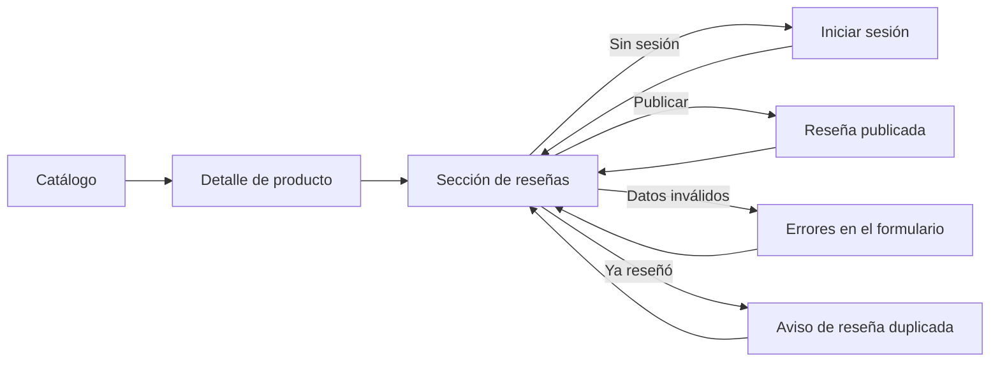

# Módulo de reseñas — Cobertura de endpoints y estados

Este documento corresponde a las pantallas asignadas a Valu. La sección de reseñas se puede abrir de forma independiente en `/productos/:productoId/resenias` (por ejemplo `/productos/1/resenias`) y está pensada para incrustarse en el detalle de producto con una sola línea: `<ReviewsSection productoId={producto.id} />`.

## Cobertura de endpoints

Fuente: `ReseniaController` del backend.

| Endpoint | UI | Servicio | Estados cubiertos |
| --- | --- | --- | --- |
| `POST /api/resenias` | Formulario "Dejá tu reseña" (`ReviewForm`) | `createReview()` | éxito, calificación obligatoria, calificación fuera de rango, comentario de más de 500 caracteres, reseña duplicada (409), producto o usuario inexistente (404) |
| `GET /api/resenias/producto/{productoId}` | Lista de reseñas (`ReviewList`, `ReviewCard`) | `getReviewsByProduct()` | carga, datos, lista vacía, error del servidor (500), producto inexistente (404) |
| `GET /api/resenias/producto/{productoId}/promedio` | Resumen con promedio y cantidad (`ReviewSummary`) | `getAverageByProduct()` | promedio con datos y promedio 0 cuando no hay reseñas |

No se creó una pantalla distinta por endpoint: la lista, el promedio y el formulario conviven en una única sección.

## Contrato de datos

`public/data/resenias.json` contiene una lista de `ReseniaDTO`, con los mismos campos y tipos que el backend:

| Campo | Tipo | Regla de validación |
| --- | --- | --- |
| `id` | número | lo asigna el servidor |
| `calificacion` | número | obligatoria, de 1 a 5 |
| `comentario` | texto o `null` | opcional, hasta 500 caracteres |
| `productoId` | número | obligatorio, positivo, debe existir en `productos.json` |
| `usuarioId` | número | obligatorio, positivo, debe existir en `usuarios.json` |

Las respuestas de error reproducen `ErrorRespuestaDTO` (`fecha`, `estado`, `error`, `mensaje`, `ruta`, `errores`) con los mismos mensajes que devuelve el backend. Igual que en el servidor, el comentario reemplaza las palabras prohibidas por `***` antes de guardarse, y solo se permite una reseña por usuario y producto.

El autor de cada reseña se resuelve con `usuarioId` contra el listado de usuarios, porque `ReseniaDTO` no incluye el nombre.

## Cómo demostrar cada estado

| Estado | Cómo verlo |
| --- | --- |
| Reseñas con datos | `/productos/1/resenias` |
| Sin reseñas | `/productos/5/resenias` o `/productos/6/resenias` |
| Producto inexistente | `/productos/99/resenias` |
| Sin sesión | Abrir cualquier producto sin iniciar sesión: aparece el aviso para ingresar |
| Reseña duplicada | Ingresar con `benja@trama.com` y reseñar el producto 1, 3 o 4 |
| Calificación obligatoria | Publicar sin elegir estrellas |
| Comentario demasiado largo | Escribir más de 500 caracteres y publicar |
| Calificación fuera de rango | "Probar estados de la interfaz", opción "Enviar calificación inválida" |
| Error del servidor | "Probar estados de la interfaz", opción "Error del servidor" |
| Reseña publicada | Ingresar con `benja@trama.com` y reseñar el producto 2, 5 o 6 |

Las reseñas nuevas se guardan en memoria mientras la aplicación está abierta; al recargar la página vuelven los datos originales.

## Wireflow



## Archivos del módulo

```text
public/data/resenias.json                       Lista de ReseniaDTO
src/services/reseniaService.js                  Acceso a datos y reglas simuladas del backend
src/components/resenias/ReviewsSection.jsx      Sección completa, reutilizable
src/components/resenias/ReviewSummary.jsx       Promedio y cantidad
src/components/resenias/ReviewList.jsx          Lista y estado vacío
src/components/resenias/ReviewCard.jsx          Reseña individual
src/components/resenias/ReviewForm.jsx          Formulario con validaciones
src/components/resenias/StarRating.jsx          Estrellas de solo lectura
src/components/resenias/StarRatingInput.jsx     Selector de estrellas accesible
src/components/resenias/resenias.css            Estilos del módulo, adaptables a celular
src/pages/ProductReviewsPage.jsx                Pantalla independiente por producto
```
