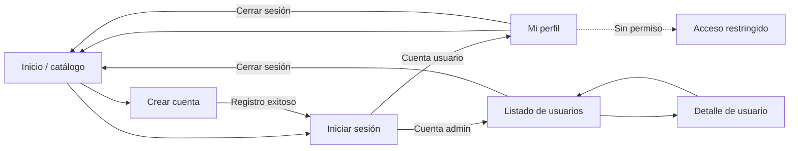

# Módulo de usuarios — Mockups y mapa de navegación

Este documento corresponde a las pantallas asignadas a Benja. El tablero visual se encuentra en [mockups-usuarios.svg](mockups-usuarios.svg) y representa las versiones de escritorio y celular.

## Wireflow

## Criterios de diseño

- Identidad visual compartida con el catálogo existente: fondos cálidos, tipografía editorial y acento terracota.
- Encabezado y pie reutilizables en todas las rutas.
- Formularios con etiquetas visibles, foco de teclado y errores asociados al campo.
- Tablas transformadas en tarjetas legibles por debajo de 760 px.
- Navegación móvil desplegable por debajo de 900 px.
- Contraste, regiones semánticas, textos alternativos y avisos con `aria-live`.

## Cobertura de endpoints

| Endpoint | UI | Estados cubiertos |
| --- | --- | --- |
| `POST /api/usuarios/registro` | Registro | campos vacíos, correo inválido, duplicado, éxito |
| `POST /api/usuarios/login` | Login | carga, credenciales inválidas, usuario y administrador |
| `GET /api/usuarios` | Listado | carga, datos, búsqueda, vacío y error |
| `GET /api/usuarios/{id}` | Perfil | carga, datos y no encontrado |

No se creó una pantalla distinta por endpoint: cada operación está representada por una pantalla, formulario o acción coherente con el flujo de compra.
